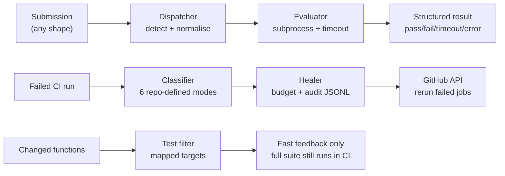

# Automated Code-Evaluation Platform with Self-Healing CI/CD

A dependency-free Python toolkit with three parts:

- **Code evaluator:** accepts submissions in many input shapes, runs them against reference solutions, and returns structured results.
- **Self-healing CI:** classifies failed CI runs into six known failure modes and retries only those, within a persisted per-run budget.
- **Fast feedback tooling:** function-level test selection for quick local runs, plus a slim multi-stage Docker image.

Unknown CI failures are never retried. They are logged to an audit file and fail the healer run loudly, so problems are not hidden by blind retries.

## Features

- Auto-detecting dispatcher for JSON object, JSON list, JSONL, CSV, `key=value` pairs, and plain lines
- Evaluator with timeouts, exception capture, and structured `pass / fail / timeout / error` results
- Classifier for six failure modes defined by this repository
- Bounded healer with a persisted retry budget and an audit JSONL
- Function-level test filtering that falls back to the full suite when unsure
- Slim `python:3.12-slim` multi-stage Dockerfile running as a non-root user
- Python 3.12 standard library only, nothing to install

## Architecture



## Quick start

Requirements: Python 3.12. No packages to install.

```bash
# Run the full test suite (70 tests)
python3 -m unittest discover -s tests -v

# Dispatcher + evaluator demo, one file per input shape (9/9 pass)
python3 examples/run_demo.py

# Healer dry run (no GitHub calls, no budget consumed)
python3 -m ci_healer.cli --repo owner/repo --run-id 42 --dry-run \
    --jobs-file examples/healer_demo_jobs.json \
    --state /tmp/healer-demo-state.json --audit /tmp/healer-demo-audit.jsonl

# Test filtering
python3 scripts/select_tests.py --changed evaluator/dispatcher.py:dispatch
python3 scripts/select_tests.py --full
```

The healer demo exits with code 2 on purpose. The demo file contains one `UNKNOWN` failure, and the healer stops visibly on it instead of reporting success.

Using the dispatcher from Python:

```python
from evaluator.dispatcher import dispatch

outcomes = dispatch("two-sum", '{"inputs": [[2, 7, 11, 15], 9], "expected": [0, 1]}')
print([(o.passed, o.actual) for o in outcomes])  # [(True, [0, 1])]
```

## Input shapes

The dispatcher tries formats in this order: JSON object, JSON list, JSONL, CSV, `key=value` pairs, plain lines.

In every shape, `input` means one argument and `inputs` means a list of arguments. Supplying both is ambiguous and is rejected.

## CI failure modes

These six modes are specific to this repository and are tested in `tests/test_healer.py`.

| Mode | Detection signals | Recovery action |
|---|---|---|
| Runner disk quota / no space left | `No space left on device`, `disk quota exceeded`, `ENOSPC` | Prune Docker images and caches, then rerun failed jobs |
| Transient dependency-install network failure | `Temporary failure in name resolution`, `Could not fetch`, `Failed to fetch` | Rerun failed jobs |
| Docker pull rate limit / timeout | `toomanyrequests`, pull rate limit, pull timeout | Wait for backoff, then rerun failed jobs |
| Runner lost communication | `Lost communication with the server`, or job conclusion `cancelled` | Rerun failed jobs on a fresh runner |
| Cache corruption / restore failure | `Cache restore failed`, cache checksum mismatch | Clear the cache key, then rerun failed jobs |
| Dependent-service startup timeout | `Timed out waiting for service … to be ready`, health-check timeout | Increase service startup wait, then rerun failed jobs |

Anything else is classified as `UNKNOWN`. It is never retried, it is written to the audit JSONL, and the CLI exits with code 2.

**Retry budget:** at most 2 attempts per (run, signature) by default, configurable with `--max-retries`. The budget is stored in a JSON state file, so rerunning the healer does not reset it. Original logs are never deleted or overwritten. The healer only reads them and writes its own state and audit files.

## Test filtering

`ci_healer/test_filter.py` and `scripts/select_tests.py` map changed function names to test files using an explicit mapping plus name matching.

1. An unknown changed function falls back to the full suite, never to an empty or reduced run.
2. Filtering is for fast local feedback only. CI (`.github/workflows/ci.yml`) always runs every test, and `--full` always selects everything.

## Docker

The `Dockerfile` is a multi-stage `python:3.12-slim` build:

- Slim base image in both stages
- No pip installs, since the project is standard library only
- Only application source is copied into the runtime stage (`.dockerignore` excludes tests, `.git`, caches, and healer state)
- Runs as a non-root `appuser`

```bash
docker build -t code-evaluation-platform .
python3 scripts/measure_image.py code-evaluation-platform
```

See `docs/docker-slimming.md` for the fat-vs-slim comparison. Image size has not been measured yet because Docker was not available where this was built. `measure_image.py` reports this and exits cleanly instead of printing a made-up number.

## Tests

70 tests, all passing:

| File | Tests | Covers |
|---|---|---|
| `tests/test_dispatcher.py` | 36 | Every input shape, precedence, ambiguity, malformed input |
| `tests/test_evaluator.py` | 11 | Reference solutions, timeout, exception capture, structured results |
| `tests/test_healer.py` | 15 | All six modes, unknown never retried, persisted budget, side-effect-free dry run, rate-limit backoff |
| `tests/test_filter.py` | 8 | Function-to-test mapping and full-suite fallback |

## Security notes

- **Untrusted code needs real sandboxing.** A subprocess with a timeout is not a sandbox. Submitted code can still read files or use the network. The local runner is for trusted demo and test code only. Production use needs a locked-down container with no network, a read-only filesystem, and resource limits.
- **Tokens are never logged or hardcoded.** The GitHub client reads `GITHUB_TOKEN` from the environment, logs only method, path, and status, and makes no mutating HTTP calls in dry-run mode.
- **Unknown failures stay visible.** They are never retried or deleted, and they fail the healer run with exit code 2.

## Limitations

- The GitHub client is tested with stubbed HTTP, not against the live API. Live use needs `GITHUB_TOKEN` and a real run id.
- Docker image size has not been measured (see the Docker section).
- The failure modes and signals are this repository's own design, not taken from any production system.

## Project layout

```text
evaluator/
  dispatcher.py          # auto-detecting input dispatcher
  reference_solutions.py # two-sum, sorted squares, fibonacci, valid parentheses
  evaluator.py           # callable + subprocess candidate runner
ci_healer/
  classifier.py          # the six failure modes
  github_client.py       # urllib GitHub API wrapper (env token, dry-run, backoff)
  healer.py / cli.py     # budget, state, audit JSONL, CLI
  test_filter.py         # function-level test selection
scripts/
  select_tests.py        # test-filter CLI
  measure_image.py       # Docker image size measurement
examples/                # one demo submission per input shape + run_demo.py
tests/                   # unittest suites (no pytest needed)
.github/workflows/ci.yml # unittest + docker build on push/PR
docs/docker-slimming.md  # fat-vs-slim notes + measurement instructions
```
